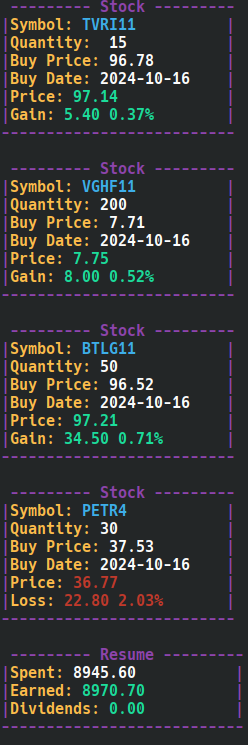

# My Homemade Stocks Analysis Tool
## Description
It's a Python command-line tool to analyze stock data from Yahoo Finance. It uses the yfinance library to fetch the data and intends to provide a simple way to analyze owned stocks and help with decisions. Tickers are treated as Brazilian B3 symbols (the `.sa` suffix is appended, e.g. `PETR4` → `PETR4.sa`).

## Features
It has some features under development, but for now the main feature are:
- List all the stocks in the portfolio:
it scans all stocks in the portfolio and prints useful info for each stock (last close, dividends, etc.) in a quick-to-read, colored layout, followed by a summary of amount spent, current value and difference.
- Add a stock to the portfolio (symbol, buy value, buy date)
- Plot a stock's price between two dates in the terminal (ASCII plot)


## Usage

```bash
pip install -r requirements.txt
python3 broker.py          # interactive menu
python3 broker.py -l       # list portfolio
python3 broker.py -a <stock> <buy value> <buy date>
python3 broker.py -p <stock> <start date> <end date>   # dates as Y-M-D
python3 broker.py -h       # help
```

The portfolio is stored in plain-text files in `my_stocks/` (`papers.txt` and `history.txt`), created on first run and ignored by git. The remove (`-r`) and sell (`-s`) options are listed in the help but not implemented yet.

## Files

| File | Purpose |
|------|---------|
| `broker.py` | Entry point: menu, argument handling, portfolio listing/adding/plotting |
| `stocks.py` | `Stock` class (Yahoo Finance queries, plotting) and portfolio file helpers |
| `bcolors.py` | ANSI color codes for terminal output |

## Planned Features
- small ascii plot for each stock
- find top 5 stocks to purchase
- use b3 api to get the own stocks
- add all in a container to run in a server

